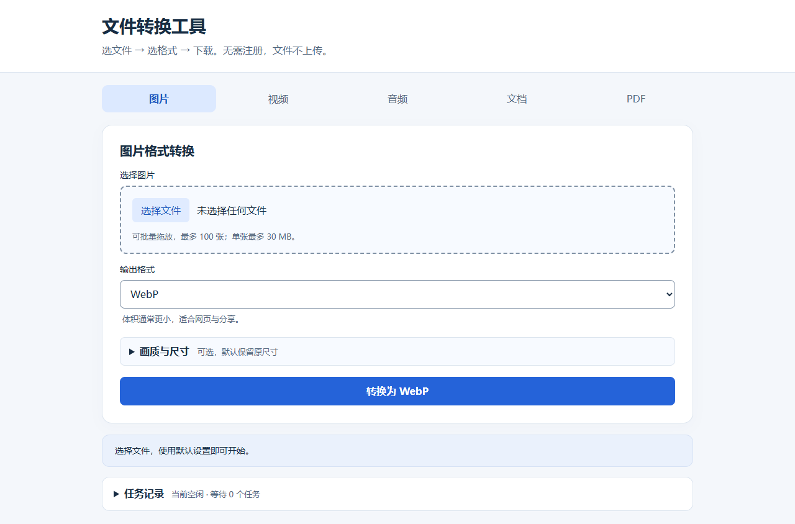

# 本地文件转换工具

[](https://github.com/wqnmlgb151/Online-conversion/actions/workflows/verify.yml)

**[打开在线工具](https://online-conversion.pages.dev/)** · [处理范围与隐私](https://online-conversion.pages.dev/privacy.html) · [阶段规划](docs/ROADMAP.md)

纯静态网站，文件在浏览器内转换，无后端、无文件上传。图片、Office、Markdown、PDF 所需脚本随站点分发；音视频转换按需下载 FFmpeg 核心，并校验 SHA-256。支持按功能准备离线资源及 PWA 清单；首次使用仍需联网，未准备的功能不保证断网可用。

界面自动跟随系统或浏览器的浅色／深色主题，设置变化后无需刷新。转换工具、使用指南与隐私说明使用同一套配色；切换主题保留当前文件、选项、任务及结果。界面主题不改变导出文件的颜色，文档 PDF 保持白底。

在线使用：[https://online-conversion.pages.dev/](https://online-conversion.pages.dev/)。Cloudflare Pages 连接 GitHub 的 `main` 分支自动构建；线上版本以最近一次成功部署为准。当前本地验收与待发布事项见 [发展规划](docs/ROADMAP.md)。

## 快速使用

1. 打开在线工具，选择图片、文档、PDF、音频或视频功能。
2. 选择或拖入文件，再选输出格式。图片可批量转换或合并为 PDF；音频、视频、文档及 PDF 文字／图片导出每次处理一个文件。
3. 点击显示目标格式的转换按钮，通过标有输出文件名的链接下载，或在结果区逐个下载、打包 ZIP。图片默认保留原尺寸，通常无需修改设置；要调整画质或宽高，再展开「画质与尺寸」。
4. 需要连续提交时，展开「任务记录」查看、移除或清空等待任务；有等待任务时会自动展开。运行中显示「取消任务」，已完成结果仍保留。要全部停止，先清空等待任务，再取消当前任务。



本阶段体验改进随本次发布提交推送；线上版本以 Cloudflare 最近一次成功部署为准。[本阶段验收与手机预览](docs/history/STAGE-6.md) · [历史批量转换预览](docs/images/preview.png)

## 离线使用与功能入口

在“离线准备与使用指南”中选择图片与 ZIP、文档、PDF 或音视频。只有对应全部资源下载并通过 SHA-256 校验后，才显示“已缓存，可离线使用”。每组包含自身需要的依赖和结果 ZIP 支持。缓存只保存程序资源，不保存文件、结果或队列。

- 页面基础资源自动缓存；功能依赖须手动准备。音视频核心约 30 MB，首次 CDN 下载失败仍需恢复网络后重试；准备成功后可断网刷新并转码。
- 可检查和清除功能缓存；页面基础资源保留。缓存由本站所有标签页共用，准备、清理和失败后的状态会同步到其他已打开页面；清理前请完成其他窗口的转换。浏览器可能因空间不足、无痕设置或清理站点数据移除缓存，离线前应检查状态。联网标识不代表 CDN 一定可访问。
- 新版本等待当前页面关闭，不强制刷新正在转换的页面。保存结果后关闭本站全部标签页/应用窗口再打开；新版本会清理旧缓存，需要重新准备功能。
- 构建时按程序和依赖内容生成缓存版本及校验清单。离线功能需要 HTTPS 或 localhost，并从 `dist` 部署。直接运行源码可转换，但不包含构建生成的离线清单。
- 支持的浏览器可从菜单安装为应用；实体手机安装行为仍需单独验收。

可收藏或分享功能入口：[#image](https://online-conversion.pages.dev/#image)、[#doc](https://online-conversion.pages.dev/#doc)、[#pdf](https://online-conversion.pages.dev/#pdf)、[#audio](https://online-conversion.pages.dev/#audio)、[#video](https://online-conversion.pages.dev/#video)。这些入口共用同一静态页面。另提供 [使用指南](guide.html) 和 [Markdown 示例](examples/sample.md)。

## 支持范围

| 功能 | 输入 | 输出与限制 |
| --- | --- | --- |
| 图片 | 多张浏览器可解码的图片 | 批量 JPG、PNG、WebP，调整尺寸；JPG 使用白色背景；动画只取首帧 |
| 视频（实验功能） | FFmpeg 可解码的视频 | MP4 / WebM、提取 MP3、前 10 秒 GIF |
| 音频（实验功能） | FFmpeg 可解码的音频 | MP3、WAV、FLAC、M4A |
| Excel | XLSX | 首个工作表转 JSON、CSV、TXT、HTML、PDF |
| 文档 | DOCX、Markdown、TXT | TXT、HTML、PDF；不生成 Word 文件 |
| PDF | 单个 PDF | 按指定页码提取文本或 PNG ZIP，每次最多导出 50 页图片 |
| 图片合并 | 多张浏览器可解码的图片 | 可调整顺序，合并为 A4 PDF |

单个图片/文档/PDF 最多 30 MB，音视频最多 200 MB，总选择大小最多 200 MB；图片最多 4000 万像素。转换后的大小与速度取决于浏览器和设备。

## 批量处理与结果管理

- 图片与 PDF 输入区支持拖拽，每批最多 100 个文件。批量图片逐个处理，损坏图片会单独记录失败，其他文件继续转换。
- 宽高留空保留原尺寸；只填一边自动保持比例；同时填写宽高且勾选保持比例时适配该范围，取消勾选则按指定尺寸拉伸。调整尺寸后最大边长 8192 像素，总像素最多 4000 万。PNG 不使用有损质量设置。
- 结果区展示图片前后尺寸和文件体积，转换后文件也可能增大。切换功能、选择新文件或后续转换失败不会丢失已有成功结果。
- 可逐个下载、删除，或将全部成功结果打包 ZIP。同名文件自动加编号，避免覆盖。结果只保留在当前页面内存中，清空或离开页面会释放；刷新后无法恢复。保留很多结果会占用更多内存。
- PDF 页码留空处理全部页面；例如 `3,1-2` 按第 3、1、2 页顺序输出，重复页码只保留一次。页码必须在文档范围内，倒序范围和空项会报错。大于 50 页的 PDF 可以选择不超过 50 页导出图片。
- 图片合并 PDF 可使用「上移」「下移」调整顺序；重新选择文件会重置为新的选择顺序。

DOCX 转 HTML / PDF 会省略图片、链接和复杂排版。文档结果附带转换限制及解析器警告。文档 PDF 使用图片分页以显示中文，文字不可搜索或复制；分页优先寻找页尾附近的空白行，复杂表格或无空白内容仍可能被截断。超长文档建议导出 HTML 后使用浏览器打印为 PDF。扫描版 PDF 提取文字不包含 OCR，完全无文字时会明确报错。TXT / Markdown 按 UTF-8 读取。输入损坏、加密或编码不支持时会显示错误。

### 任务与资源限制

- 图片、音视频、文档、PDF 与结果 ZIP 共用串行队列，同时只执行一个任务；图片批次逐个转换。进度条按文件、页面或引擎报告更新，依赖加载时显示不确定进度。
- 运行时仍可切换功能、选择文件与修改选项；每次提交保存当时的文件、格式、尺寸、比例、PDF 页码和合并顺序，后续表单变化不会改变已提交任务。
- 最多等待 8 个任务，运行及等待输入合计最多 200 MB。可单独移除等待任务或清空等待队列；失败不阻塞后续任务。任务记录最多保留最近 20 条元数据，完成或移除后释放队列持有的文件引用。刷新不恢复任务。
- 取消会中止 FFmpeg 下载/引擎及当前 PDF 图片渲染；其他步骤在下一个检查点停止。浏览器同步解析及文档截图期间可能暂时无法响应点击，取消不是即时终止所有计算。
- 成功结果累计最多 128 MB。画布、PDF 图片 ZIP、合并图片和音视频按保守估算检查 256 MB 工作预算，超限提示缩小尺寸、减少页数或清空结果。预算也计入已保留的结果 ZIP；重新打包前释放旧 ZIP，避免新旧归档同时占用内存。
- 预算是应用估算，**不是浏览器进程内存硬上限**。图片源尺寸在解码后检查，Office 解压、浏览器解码及 WASM 内部内存不能完全预估；小体积复杂文件仍可能占用较多资源。音视频 200 MB 是选择上限，实际转换还受工作预算限制。

依赖加载失败后可点击「使用当前选择重试」，使用该功能表单当前选择的文件与选项重新提交，无需刷新页面。音视频转码约两分钟超时后会释放引擎；体积上限不保证所有设备都能处理大文件。完整说明见 [处理范围与隐私说明](privacy.html)。

## 本地运行

在项目目录执行：

```sh
python -m http.server 8080
```

访问 `http://localhost:8080`，推荐 Chrome / Edge。不要直接通过 `file://` 打开：FFmpeg Worker 需要 HTTP(S) 同源脚本。

验证离线与 PWA 时先执行 `npm run build`，再执行 `node scripts/serve.cjs dist`。

## 部署

开发目录可直接运行。正式发布建议生成只包含网站资源的 `dist` 目录：

```sh
npm run build
```

构建只使用 Node 内置模块，不依赖测试包。将 `dist` 上传到静态托管平台，无需后端。FFmpeg 使用单线程核心，不要求 COOP/COEP 响应头。首次转换需下载约 30 MB 核心；WASM 保留在外部 CDN，不加入发布目录。构建会检查依赖文件 SHA-256 和单文件大小。

### Cloudflare Pages 连接 GitHub

选择仓库 `wqnmlgb151/Online-conversion`，填写以下设置：

| 设置 | 值 |
| --- | --- |
| 生产分支 | `main` |
| 框架预设 | `None` |
| 构建命令 | `npm run build` |
| 构建输出目录 | `dist` |
| 根目录 | 留空（仓库根目录） |

无需应用密钥或服务端。已使用旧配置 `exit 0` / `.` 的项目应改为上述设置，避免发布测试代码和安装目录。部署后检查图片转换、文档转换以及音视频引擎加载；CDN 无法访问时，对应功能会提示错误。关联 GitHub 后，推送到生产分支会触发自动部署。

离线功能必须发布构建产物：`npm run build` 会生成 `dist/offline-assets.js`，源码根目录不包含该文件。修改构建设置后，需要重试部署或推送新提交，等待新部署成功，再验证生产地址。

可打开站点的 `/offline-assets.js` 核查发布结果：应返回以 `self.OFFLINE_ASSETS =` 开头的 JavaScript，包含资源版本、分组与校验值。若返回首页 HTML，即使状态码为 200，也表示离线清单未正确发布；请查看本次部署使用的构建命令、输出目录及构建日志。GitHub 仓库访问警告应结合新部署的克隆日志判断，不能仅凭警告认定仓库权限不足。

参考：[Cloudflare 静态 HTML 部署文档](https://developers.cloudflare.com/pages/framework-guides/deploy-anything/)。

`vendor/ffmpeg` 中的两个脚本来自 `@ffmpeg/ffmpeg@0.12.10`，必须保留在同一目录。包装库采用 MIT 许可证，见随附 LICENSE；FFmpeg 核心及编解码器有各自的许可证，发行时需自行核对。

全部依赖的固定版本、来源和许可证见 [vendor/manifest.json](vendor/manifest.json)，文件校验值见 [vendor/checksums.json](vendor/checksums.json)。维护者可使用 `scripts/download-vendor.ps1` 获取缺失依赖；更新版本需重新评审并运行全部测试后更新校验值。

## 验证

```sh
npm ci
npm run check
npm test
npm run vendor:check
node scripts/cache-core.cjs
npm run test:e2e
```

需要 Node.js 24 和已安装的 Chrome。Windows 下载测试核心可改用 `powershell -File scripts/cache-core.ps1`。测试缓存位于 `.test-cache`，不会提交或发布。

Chrome 测试直接访问 `dist` 发布目录，使用真实 PNG、XLSX、DOCX、中文 Markdown / TXT、PDF、WAV 和一秒合成视频，验证输出可以重新解码或渲染，以及损坏文件、依赖失败和重试。音视频测试用已校验的缓存响应 CDN 请求，不依赖每次实时下载；上线后的 CDN 连通性需要另行冒烟验证。

`npm run media:probe` 忽略测试缓存，重新下载正式 CDN 的 JS 与 WASM，验证完整 SHA-256 和公开 CORS 响应；不会覆盖已有测试核心。此结果只代表执行时的网络可达性。

`npm run build` 同时核查实际 `dist` 目录：拒绝多余文件和符号链接，检查离线资源校验值、版本、PWA 范围，以及 [Cloudflare Pages 单文件 25 MiB 限制](https://developers.cloudflare.com/pages/platform/limits/#file-size)。构建不会删除多余文件，发现后需先移走再重建，避免误发布测试或历史产物。

GitHub Actions 配置见 `.github/workflows/verify.yml`，失败时保存浏览器截图和 trace。测试样本是合成文件，不能代表所有复杂排版、编码、大文件和移动设备。

可单独执行 `npm run test:pressure`：检查 1 万行工作簿、含表格与链接的 DOCX、1000 页 PDF 选页、超大 PDF 页面拒绝、重复 ZIP 释放，以及 1200 万像素纹理图片在手机触控模拟和 4 倍 CPU 降速下的转换。重复转换会检查 Blob URL 释放和队列记录上限；这不等同于测量浏览器实际堆内存回收。真实用户文档及实体手机仍需要单独验收。

本地测试产物位于 `test-results/local` 和 `playwright-report/local`，线上测试位于对应的 `live` 子目录，避免两个运行互相清理文件。

常规转换用例禁用 Service Worker，保证网络失败注入可控；`offline.spec.cjs` 显式启用真实 Service Worker，覆盖断网重载、图片及 ZIP 解码、未准备功能、缓存篡改与恢复、音视频下载失败重试及离线解码、跨标签页准备与清理、更新等待及旧版本清理。音视频离线测试用固定校验缓存响应首次 CDN 下载，不代表当时真实 CDN 的可用性。

### 线上验收

```sh
node scripts/cache-core.cjs
node scripts/generate-media.cjs
npm run test:live
```

可用 `npm run test:offline-live` 单独验证线上离线准备、图片 ZIP、文档与 PDF Worker、真实 CDN 音频缓存及跨标签页状态同步。该专项启用 Service Worker，不替换网络响应；下载和校验失败会让测试失败。常规线上失败注入用例禁用 Service Worker，避免缓存拦截绕过测试注入。

线上验收直接访问 Cloudflare Pages，复用批量处理用例，并验证 Office / PDF 与音视频输出。FFmpeg 核心使用真实 CDN 下载，不使用本地缓存替换网络响应；缓存核心仅用于生成合成视频输入。依赖失败恢复用例会主动中断一次 Excel 脚本请求，再恢复正常网络。历史检查记录见 [线上验收记录](docs/history/LIVE-VERIFICATION.md)。可用 `LIVE_BASE_URL` 环境变量指定其他已部署地址。

## 项目维护

目录职责、测试缓存、产物清理和报告恢复方式见 [维护说明](docs/MAINTENANCE.md)。当前状态与下一步见 [发展规划](docs/ROADMAP.md)；阶段验收记录统一归档于 `docs/history/`，其中测试数量与发布状态仅代表记录当时的版本。
