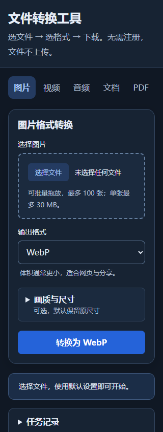

# 阶段 6：降低首次使用门槛

首次验收：2026-10-14，基线为 `88ec29e`；当时未提交或推送。2026-10-29 按用户授权补齐下载引导、复验并纳入发布提交，记录见下文。

## 改进

- 首屏先展示功能选择、文件选择、输出格式与转换按钮；任务记录、离线准备和完整使用限制放在主要操作之后。
- 图片画质、尺寸与比例折叠为可选设置，默认保留原尺寸。原有质量取值、尺寸规则和批量转换逻辑保留。
- 转换按钮显示目标格式，批量图片显示文件数量；JPG、PNG、WebP 的特点在选择格式时说明。
- 音频、视频、文档也支持拖放，并展示文件名与大小。单文件功能拒绝一次拖入多个文件，保留之前的有效选择。
- 任务记录默认折叠，有等待任务时展开，保留移除、清空与取消能力。取消按钮只在任务运行时显示。
- 320 像素宽的页面也能直接看见全部五个功能入口，手机标签触摸高度不小于 44 像素。

仍为纯静态应用，在浏览器内处理文件，无账号、无上传接口。没有增加依赖或更改输出格式的默认选择，也没有修改项目外的应用配置。

## 本地验收

- `npm run check`：通过。
- `npm test`：29 项通过。
- `npm run build`：34 个发布文件及依赖、离线清单校验通过。
- `npm run test:e2e`：81 项 Chrome 全量通过，包含实际图片、Office、Markdown、PDF、音视频输出、失败恢复、队列、取消、离线与主题。
- 全量之后修正窄屏标签和空闲取消按钮；最终版本复验 `experience`、`task-control`、`queue`、`theme`，17 项通过，单元与构建再次通过。
- 最后补齐首屏的图片批量数量提示，重新构建并复验 4 项体验用例通过，预览图由这一版生成。
- 检查 320、390、1280 像素视口和深浅主题；首屏转换按钮在 844 像素高度内，页面没有横向溢出，五个功能入口均在可见区域。
- 拖放文档后生成实际 TXT，核对内容；多文件误拖不替换已有选择；默认图片输出及展开设置后的尺寸分别为 4×2、12×6，之前结果保留。

测试只使用合成文件。音视频全量用例使用已有且通过校验的核心缓存，不代表再次验证公网 CDN。没有进行实体手机、其他浏览器或生产站点验收。

## 预览

以下为本地构建首屏，尚未发布。

## 下一步

本阶段发布后停止。后续优先验证生产站点的新首屏、离线升级与实体手机操作，再根据反馈改善格式选择建议。

## 2026-10-29 发布复验

- 统一下载入口显示实际输出文件名；结果列表的下载链接具有含文件名的无障碍名称。删除最新结果后，主下载入口回到上一份有效结果，文件名和地址同步更新；长文件名允许换行。
- `npm run check`、`npm test`（29 项）、`npm run build`（34 个发布文件）通过；依赖校验通过。
- 构建并生成合成音视频后，直接执行 `node node_modules/@playwright/test/cli.js test`：81 项 Chrome 全量通过，包含新增下载链接回归。未修改依赖和测试启动脚本。
- 本机 `npm run test:e2e` 的包装调用停在测试启动前，已终止；上面的拆分命令完成同一套全量回归。不将包装调用记为通过。
- 11 份 Markdown 的 44 个本地链接检查通过；复核窄屏预览及源码差异。
- 按用户授权提交、推送；推送后按维护规则清理可重建报告与浏览器临时快照，保留 FFmpeg 缓存、发布构建和被文档引用的预览图。
- 本轮未验证生产部署、实体手机及公网 CDN；GitHub 推送成功不等于 Cloudflare 部署成功。
